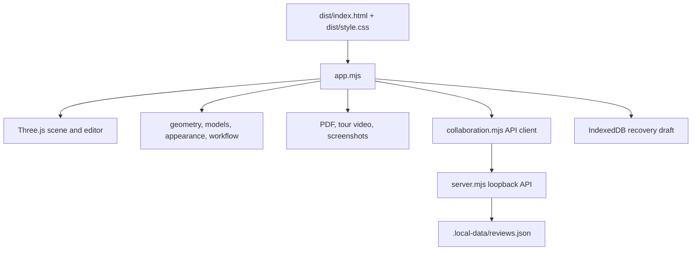

# Claude Code project handoff

This file is the onboarding map for **Forma Booth Studio**, an AI-assisted local MVP for designing exhibition booths in 3D, preparing concept PDFs, and collecting review feedback. Treat the directory containing this file as the repository root. The project is a local prototype; it is not a production hosting service and its print dimensions are not supplier-certified.

## Quick start

Requirements: Node.js 20 or newer, npm, and a WebGL-capable browser.

```sh
npm ci
npm run build
npm start
```

Open <http://localhost:4174/>. The local server binds only to `127.0.0.1`. Keep the server terminal open while using the app; stop it with Ctrl+C. Set `PORT=4180 npm start` to use another local port. The local data store is keyed by the app's data directory, not by account or cloud identity.

Useful commands:

```sh
npm run dev       # Alias for the local server
npm run local     # Alias for the local server
npm run build     # Bundle app.mjs and its imports to dist/app.js
npm test          # Run the unit/regression scripts
```

`dist/app.js` is generated and ignored by Git. Run the build after changing JavaScript source and before opening a fresh checkout in the app. The tracked browser sources are `dist/index.html` and `dist/style.css`. When changing their referenced JavaScript/CSS cache versions, update the `?v=` values in `dist/index.html`.

## What the app currently does

- Builds a booth with a width, depth, default wall height, back wall and optional left/right return walls. Users can split, merge, resize and change the height of individual modular wall panels, including half-height panels.
- Applies PNG/JPEG artwork to wall panels and generated printable props. Panels use a centred crop for the visible print face.
- Adds built-in furniture and library assets, or uploads supported GLB models. Users can select, drag, snap, rotate, resize, group, align, lock and duplicate objects. Some generated library objects support artwork. Built-in and uploaded models support colour/finish overrides and image textures on UV-mapped materials.
- Orbits or walks around the live scene, with lighting and environment controls. Saved camera views appear in screenshot exports.
- Exports branded concept proposals and technical appendices as multi-page PDFs, PNG screenshots, and 15- or 20-second video orbits. Video now starts facing the open front by default, returns to its opening camera pose at the end, and exposes starting-angle, elevation and distance controls.
- Saves a browser recovery draft and, after a named project is created, autosaves named projects to the local Node server. It supports frozen local review revisions with comments, change requests, concept approvals and revocable local review links.
- Includes a Free/Studio library-plan demonstration only. There is no payment provider, actual subscription entitlement, customer account system, cloud sync or public hosting configuration.

## Architecture at a glance



### Source map

| Path | Responsibility and useful entry points |
| --- | --- |
| `app.mjs` | Browser application orchestrator. Imports all feature modules, owns the active mutable project object `s`, creates the Three.js scene and renderer, builds booth geometry, wires UI events, manages history and persistence timers, initializes share/review modes, generates PDF pages, and installs drag, lighting, tour, workflow, inspector and appearance controls. Start here to trace a complete UI action. |
| `geometry.mjs` | Project defaults, panel layout calculation, per-panel editing, object dimensions, advisory boundary/clash checks, and central validation. Physical geometry is stored in millimetres. This is the authority for panel dimension formulas and accepted project fields. |
| `models.mjs` | GLB inspection, base64 helpers, Three.js GLTF loading, model instance cloning and fitting into user-supplied dimensions. |
| `library.mjs` | Built-in library catalogue and procedural/generated GLB models, thumbnail data, item categories and library model generation. |
| `appearance.mjs` | Applies colour, finish and texture settings to generated and imported Three.js materials; builds the object appearance editor. |
| `imageAssets.mjs` | Inspects PNG/JPEG dimensions and size before browser decoding; shared image dimension limits and format checks. |
| `dragging.mjs` | Pointer-driven object movement, selection, group movement, snapping, panel/object hit handling and walk-mode interaction guards. |
| `workflow.mjs` | Object group membership, group movement, footprint calculations, alignment, support placement, saved camera views and floating editor workflows. |
| `inspector.mjs` | Selection editor panel for the selected wall panel or object. |
| `editing.mjs` | Undo/redo history and IndexedDB browser recovery draft store. |
| `saving.mjs` | Named-project save-state comparison and user-visible save-status strings. |
| `collaboration.mjs` | Browser client for `/api/*`, project/library/review dialogs, frozen review experience, review links, review events, and demo plan selector. It does not call an external collaboration service. |
| `workspace.mjs` | Review status rules and removal of owner-only project metadata from review snapshots. |
| `share.mjs` | Compressed, size-bounded read-only visual snapshot URL encoding/decoding. It intentionally excludes uploaded GLBs and reduces artwork to preview material. |
| `branding.mjs` | Concept proposal defaults, validation and simple company-colour helpers. |
| `lighting.mjs` | Project lighting defaults, applying lighting to the Three.js scene, and lighting controls. |
| `environment.mjs` | Decorative exhibition hall geometry. Other environment choices are mainly colour/backdrop treatments. |
| `tour.mjs` | Video format support selection, closed camera orbit position calculation, video recording dialog, video and screenshot capture. |
| `server.mjs` | Loopback-only HTTP static server and JSON API for local projects, revisions, comments/decisions, and demo plan state. Persists the database to disk. |
| `dist/index.html` | Maintained HTML interface shell: header, tabs/forms, editor dialogs and CSS/JS entry points. Dynamic collaboration and tour dialogs are created in JavaScript. |
| `dist/style.css` | Maintained app styling, dialog styling and responsive layout. |
| `dist/app.js` | Generated esbuild bundle; intentionally ignored and regenerated from `app.mjs`. Do not edit it by hand. |
| `examples/sample-project.json` | Small importable project for trying the app without customer assets. |
| `.github/workflows/ci.yml` | GitHub Actions workflow: Node 20, `npm ci`, `npm test`, then `npm run build` on pushes and pull requests. |
| `README.md` | User-facing product features, quick start, print assumptions, limitations and workflows. |
| `CONTRIBUTING.md`, `SECURITY.md` | Change workflow and local-only security guidance. |

### Tests

`npm test` runs the scripts below, in order. CI runs the full suite and a build. The browser/visual experience still needs manual review in a WebGL browser for UI or rendering changes.

| Test script | Main area |
| --- | --- |
| `tests.mjs` | Panel geometry and provisional printable-size calculations. |
| `share-tests.mjs` | Snapshot stripping, encoding/decoding and size limits. |
| `model-tests.mjs` | GLB structure and model validation. |
| `editing-tests.mjs` | Undo/redo behavior. |
| `branding-tests.mjs` | Proposal fields and branding validation. |
| `local-tests.mjs` | Local project persistence behavior. |
| `dragging-tests.mjs` | Drag coordinate and snapping logic. |
| `saving-tests.mjs` | Named-project dirty/saved/error status. |
| `tour-tests.mjs` | Recording format selection and orbit closure. |
| `workflow-tests.mjs` | Grouping, object placement/alignment and review-state workflow. |

## Browser and server startup flow

1. `npm start` runs `server.mjs`, which serves only the whitelisted app files from `dist/` and exposes the local `/api/*` routes.
2. `dist/index.html` loads `dist/style.css` and the built `dist/app.js` bundle.
3. `app.mjs` constructs the initial project using `defaults()` from `geometry.mjs`, creates a Three.js scene, renderer, lights and OrbitControls, then initializes UI and feature modules.
4. `initializeProject()` checks the URL. `#view=` opens a compressed read-only preview snapshot; `#review=` loads a saved frozen review from the local API; otherwise it restores the IndexedDB draft and optional named project.
5. `sync()` updates form fields and calls `build()`. `build()` updates lighting/environment and reuses object transforms when possible; geometry or asset changes rebuild the scene group. `renderer.setAnimationLoop()` draws the interactive editor except while a separate video renderer is recording.
6. Edits go through validation/history and schedule browser draft persistence. When a project has a `workspaceId`, changes also schedule a local server save after approximately 1.5 seconds of inactivity.

`app.mjs` is compact and currently combines several responsibilities. Feature logic should preferably be placed in the existing focused module (or a new small module), with `app.mjs` responsible for composition and state transitions. Check references before renaming project fields because the browser, JSON import/export, share snapshots and server all consume the project schema.

## Project data model

`geometry.mjs` `defaults()` creates the project object. The schema has `version: 1`; optional fields are used to keep older project JSON compatible. Major fields:

| Field | Meaning |
| --- | --- |
| `width`, `depth`, `height`, `module` | Booth footprint, default wall height and target maximum module width; millimetres. |
| `left`, `right` | Whether side return walls exist. Back wall is present by default. Front aisle edge is open. |
| `thickness` | Nominal wall/frame thickness; millimetres. |
| `inset`, `finish`, `bleed`, `safe`, `maxPrint` | Provisional supplier allowances, safe inset and maximum cut width; millimetres. |
| `wallLayouts` | Optional explicit panel rows grouped by `B`, `L`, `R`, each row `{id, w, h?}`. Omitted layouts are derived from `module` and wall length. `h` overrides default `height`. |
| `panels` | Panel-specific colour and/or artwork asset keyed by panel ID. Artwork is embedded as a data URL with name and pixel dimensions. |
| `objects` | Furniture/props and GLBs, with IDs, type, millimetre centre coordinates `x/z`, rotation `rot`, optional floor elevation `y`, dimensions, lock/group state and appearance overrides. |
| `models` | Embedded GLB assets indexed by `modelId`, including base64 data, byte count, name and declared model size in mm. |
| `objectTextures` | Embedded PNG/JPEG assets used by object material appearance overrides. |
| `environment`, `lighting` | Scene backdrop choice and lighting settings. |
| `cameraViews` | Optional saved camera positions/targets for screenshots. |
| `proposal` | Optional customer/company brand, logo, event, rationale, revision and planning-budget fields for PDFs. |
| `workspaceId`, `workspaceVersion` | Local server project key/version used for optimistic concurrency. Removed from standalone content hashes and review copies. |

The coordinate origin is the back-left outside corner: **X** runs across booth width, **Z** runs toward the open front, **Y** is vertical. Interactive rendering converts mm to Three.js metres by dividing by 1,000. Equipment coordinates represent footprint centre; rotations are about vertical Y. The default coordinates and supported ranges live in `geometry.mjs`.

## Panel and PDF geometry rules

`panels(project)` in `geometry.mjs` is the source of truth for panel geometry. For each module:

```text
visible = nominal - 2 × frame inset
cut = visible + 2 × finishing allowance
artwork canvas = cut + 2 × bleed
safe = visible - 2 × safe inset
```

Back wall length equals booth width. Each active side return is depth minus frame thickness. Custom panel widths must sum exactly to their wall run. Split keeps the original artwork on the original half; merge removes the following panel and its art. Default half-height panels start at the floor. The PDF draws elevations, equipment plan, individual panel specification pages, an asset manifest, validation findings and optional branded proposal/approval pages.

These are provisional symmetric allowances and butt-joint assumptions. The output is for concept/supplier discussion, **not validated print-ready artwork**. No production bleed extension, cutter path, CMYK proofing, font embedding, substrate calibration, proprietary SEG/wrap rule, structural review, accessibility check, or installer sign-off is generated. Supplier specifications must replace these assumptions before manufacture.

## Persistence, sharing and review

- **Browser recovery:** `editing.mjs` writes the current draft to IndexedDB database `forma-drafts`, object store `drafts`, key `current`. This is tied to the same browser profile and origin/port.
- **Named local projects:** `collaboration.mjs` calls `server.mjs` after the user creates/saves a named project. The server stores projects and review data in `.local-data/reviews.json` by default. `FORMA_DATA` can point to another private directory. Save conflicts use `workspaceVersion`; a 409 conflict requires the user to preserve/download the current JSON rather than silently overwrite.
- **Project file:** the editor downloads/imports JSON. Embedded original artwork, GLB and textures can make it large. The app/server impose a 60 MB request/import ceiling.
- **Visual share URL:** `share.mjs` uses gzip + URL-safe base64 in `#view=`. It strips contact/supplier notes, includes reduced artwork preview material, rejects GLB models, and limits the compressed payload to roughly 32 KB (decompressed content bounded to 2 MB). It is intended for visual preview, not full asset transfer.
- **Review URL:** `#review=` points to a frozen revision stored in the local server. Each revision keeps its own snapshot and review events. Names are self-declared. Comments do not change review status; the latest approve/change request does. Revocation blocks later requests, but cannot recall content already downloaded or loaded.
- **Demo plans:** `/api/plan` stores `free` or `studio` as local UI state only. There is no payment or server-enforced paid entitlement.

The server has no account model or tenant separation: anyone who can access this loopback process shares the workspace. Do not bind it publicly, tunnel it, or deploy it as a customer service. See `SECURITY.md` before changing networking or storage behavior.

## API surface in `server.mjs`

The client helper `api()` in `collaboration.mjs` prefixes paths with `/api/` and sends JSON. The server validates project payloads with `validate()` from `geometry.mjs`.

| Route | Method | Purpose |
| --- | --- | --- |
| `/api/workspace` | GET | Lists demo plan, project summaries and revisions. |
| `/api/projects` | POST | Create/update a project, with `workspaceVersion` conflict check. |
| `/api/projects/:id` | GET | Load full saved project. |
| `/api/projects/:id/duplicate` | POST | Create a copy. |
| `/api/projects/:id/archive` | POST | Archive/restore. |
| `/api/projects/:id/rename` | POST | Rename a saved project. |
| `/api/plan` | POST | Change local demo plan to `free` or `studio`. |
| `/api/revisions` | POST | Create a frozen snapshot after validation. |
| `/api/review/:token` | GET | Load a non-revoked review revision. |
| `/api/review/:token/events` | POST | Add `comment`, `changes`, or confirmed `approve` event. |
| `/api/review/:token/revoke` | POST | Revoke a review token. |

Requests are serialized through an in-process promise queue. The JSON database is written to a temporary file then renamed. This is appropriate for a local prototype, not a multi-process or cloud database.

## Uploads and rendering constraints

Current guards are documented in `README.md` and implemented at the relevant upload boundary:

- Wall PNG/JPEG: 8 MB each; 4,096 px maximum edge and 12 megapixels.
- Logo, prop artwork and object textures: 2 MB each; same edge/pixel limits.
- GLB: embedded, uncompressed GLB 2.0, 10 MB each; at most 12 model assets and 30 MB total. External URLs, Draco/Meshopt compression and KTX textures are not supported. Uploaded object dimensions are user-confirmed, not inferred as verified physical measurements.
- Object texture library: at most 12 images / 12 MB per project; UV mapping is required. Texture placement follows the model's authored UVs.
- Project import and API JSON body: 60 MB. Local disk usage grows as full project snapshots/revisions are retained.
- Video: browser `MediaRecorder` support decides MP4/WebM availability. 720p, 1080p or 4K at up to 30 fps, 15/20 seconds. High resolutions may drop frames. No audio or server-side conversion. The recording uses a separate renderer/camera; editor camera is left alone.

Browser capability and GPU memory vary. An image that fits file-size limits can still use substantial decode/texture memory. Large projects and 4K output can exhaust a browser's graphics resources.

## Making changes safely

1. Read the relevant section in `README.md`, then inspect the focused source module and its call sites in `app.mjs`.
2. Keep project-schema updates coordinated across `geometry.mjs` validation/defaults, `app.mjs` editing, JSON import/export, snapshot transforms in `share.mjs`, and server persistence/review flows where relevant. Preserve optional-field compatibility for existing version-1 projects unless deliberately migrating the schema.
3. For UI controls, update `dist/index.html` or the module that builds dynamic dialogs, plus `dist/style.css`. Keep labels/status accessible and ensure view-only review modes cannot mutate a project.
4. For scene/print calculations, retain mm as the data unit and convert only at the renderer boundary. Preserve the concept-vs-production disclaimers in `README.md` and generated PDF language.
5. For upload changes, enforce limits before expensive decoding, validate imported JSON server-side, and do not put user assets or private `.local-data` into Git.
6. Build with `npm run build`; run the relevant script or full `npm test` for code changes. Inspect changes with `git diff --check` and review the rendered workflow in a WebGL browser when UI/3D output changes.
7. Do not hand-edit `dist/app.js`; it is a generated file. Update the `?v=` cache value in `dist/index.html` when changing the corresponding static JS/CSS entry point.

## Repository and release notes

- The GitHub Actions workflow on push/PR runs `npm ci`, `npm test` and `npm run build` using Node.js 20.
- `package-lock.json` is the dependency lockfile; use `npm ci` for reproducible install.
- `.local-data/`, `.env*`, keys, model/artwork uploads, and project backups are ignored or explicitly prohibited from commits.
- The repository is marked `UNLICENSED`; public GitHub visibility does not grant reuse rights. Do not add a licence or claim open-source usage rights without the owner's decision.
- Git remote currently configured for this project is `origin` (`https://github.com/Marcman800/3d-booth-configurator.git`).
